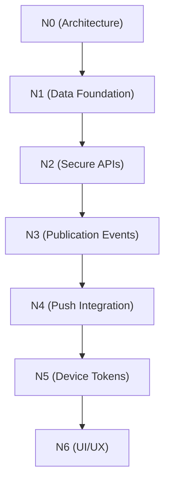

# Syaahi Notifications — Architecture Specification

**Initiative:** `phase_noti`
**Version:** v0.1 (N0 Design)
**Date:** 2026-10
**Status:** Awaiting owner approval
**Checkpoint tag:** `v-noti_N0`

---

## 1. Scope and Non-Goals

### In scope for v0.1

- Persistent, user-specific in-app notification inbox.
- Push notifications as a supplementary delivery channel.
- Notifications triggered by new poem publication.
- Recipient eligibility limited to users who have explicitly opted in.
- Mark one notification as read.
- Mark all notifications as read.
- Notification preference management (opt-in / opt-out).
- Secure recipient isolation (user A cannot read user B's notifications).
- Reliable creation of notification records at publication time.
- Safe navigation from a notification to its associated poem.
- Testing, operational diagnostics, and documented release procedures.

The persistent in-app inbox is the source of truth. Push delivery is supplementary.
A failed push must not erase a notification that has already been persisted.

### Explicitly out of scope

- Followers-only notification rules.
- Building a follow system to support notifications.
- Notifications for hearts, reactions, comments, or unrelated activities.
- Redesigning the existing poem feed or publication workflow.
- Replacing the existing authentication system.
- Broad database permission changes unrelated to this feature.
- Automatic deletion, merging, or modification of poems.
- The Syaahi Poem Integrity Engine.

---

## 2. Existing Architecture — Evidence-Backed Findings

### 2.1 Backend stack

| Component | Technology | Evidence |
|---|---|---|
| Runtime | Node.js, Express 5.x | `syaahi-backend/package.json` |
| Language | TypeScript 6.x | `tsconfig.json`, `package.json` |
| ORM | Prisma 6.x | `prisma/schema.prisma`, `package.json` |
| Database | PostgreSQL (Supabase hosted) | `env.ts` — `DATABASE_URL`, `DIRECT_URL` |
| Validation | Zod 4.x | All `*.schemas.ts` files |
| Auth | Custom JWT (HS256) | `src/middleware/auth.ts` — `jsonwebtoken` |
| Deployment | Vercel serverless | `vercel.json` — all routes → `src/api.ts` |
| Rate limiting | `express-rate-limit` (in-memory) | `src/middleware/rateLimiter.ts` |

### 2.2 Module structure

Every feature follows the same layout (ADR-001, ADR-020):

src/modules/<feature>/
├── <feature>.routes.ts # Route definitions + middleware chain
├── <feature>.controller.ts # Request handlers + business logic
└── <feature>.schemas.ts # Zod validation schemas


Notifications will follow this pattern as `src/modules/notifications/`.

### 2.3 Response envelope

All responses use a consistent shape (verified in `errorHandler.ts`, all controllers):

**Success:**
```json
{ "success": true, "data": { ... } }
```

#### Validation error (400):

```JSON
{ "success": false, "message": "Validation error", "errors": { "field": ["..."] } }
```

#### Application error (4xx/5xx):

```JSON
{ "success": false, "message": "Human readable message" }
```

#### 2.4 Database schema (existing models)

| Model | ID type | Key relations | Cascade |
| --- | --- | --- | --- |
| User | UUID v4 | poems, reactions, hearts, followers, following, rooms | — |
| Poem | UUID v4 | author → User, reactions, hearts, rooms | onDelete: Cascade on author |
| Reaction | UUID v4 | user, poem | onDelete: Cascade both |
Heart | UUID v4 | user, poem | onDelete: Cascade both |
Follow | Composite | follower, following | onDelete: Cascade both |
Room | UUID v4 | members, poems | — |
RoomMember | Composite | user, room | onDelete: Cascade both |
PoemRoom | Composite | poem, room | onDelete: Cascade both |


No notification model exists. The schema is a clean slate for N1.

### 2.5 Flutter stack

| Component | Technology | Evidence |
| --- | --- | --- |
| State management | Riverpod (StateNotifier) | pubspec.yaml, all *_providers.dart |
| Routing | GoRouter 14.x | app_router.dart |
| HTTP client | Dio 5.x | api_client.dart |
| Token storage | flutter_secure_storage | token_storage.dart |
| Feature layout | features/<name>/{data,presentation,state}/ | File tree |
| Target platform | Android only | pubspec.yaml — ios: false |
| Supabase SDK | Not installed | Not in pubspec.yaml |
| Push packages | None installed | Not in pubspec.yaml |

### 2.6 Database security model

- No RLS policies found. No SQL migration files or `supabase/` directory exist in the repository.
- Single privileged connection. Prisma connects via `DATABASE_URL` (pooler) and `DIRECT_URL` (migrations). 
  All access control is enforced at the application layer in Express controllers.
- No direct Flutter-to-Supabase access. The Flutter app communicates exclusively through the Express API via Dio.
- Cascade deletes handle orphan cleanup for all existing relations.

This means notification isolation must be enforced in the Express controller layer, consistent with how poem ownership is enforced today (`existing.authorId !== req.user.userId` checks in `poems.controller.ts`).

## 3. Authentication and Authorization Map

### 3.1 Complete request path

```text
Flutter (Dio)
  → ApiClient interceptor attaches "Authorization: Bearer <jwt>"
    → Express: authenticate middleware (src/middleware/auth.ts)
      → jwt.verify(token, env.JWT_SECRET)
        → req.user = { userId: string, email: string }
          → Controller uses req.user.userId as trusted identity
            → Prisma query with authorId/userId filter
              → PostgreSQL4
```

### 3.2 Identity trust model

| Aspect | Current behavior | Notification implication |
| :--- | :--- | :--- |
| **Token type** | Custom HS256 JWT | Reuse same authenticate middleware |
| **Payload** | `{ userId, email }` | `req.user.userId` is the trusted recipient identity |
| **Storage** | `flutter_secure_storage` | No changes needed |
| **Expiry** | 7 days (default) | Accepted limitation (ADR-003) |
| **Revocation** | None (client-side logout only) | Accepted limitation; does not block notifications |
| **Verification** | Server-side `jwt.verify` | Notification endpoints use identical verification |


### 3.3 Authorization rules for notifications

| Operation | Rule | Enforcement |
| :--- | :--- | :--- |
| **Read notifications** | User can only read their own | `WHERE recipientId = req.user.userId` |
| **Mark read** | User can only mark their own | `WHERE id = :id AND recipientId = req.user.userId` |
| **Mark all read** | User can only mark their own | `WHERE recipientId = req.user.userId` |
| **Read preferences** | User can only read their own | `WHERE userId = req.user.userId` |
| **Update preferences** | User can only update their own | `WHERE userId = req.user.userId` |
| **Create notifications** | Server-side only (publication event) | No client endpoint for creation |

**Critical rule**: The notification API must NEVER trust a client-supplied recipientId. The recipient is always derived from req.user.userId in the authenticated middleware.

## 4. Publication Event Lifecycle

### 4.1 Current publication path (verified)

```text
WriterScreen._publish()
  → WriterNotifier.publish()
    → PoemsRepository.createPoem()          // POST /api/v1/poems
      → createPoemSchema.parse(req.body)    // Fields: title, content, language, emotion, theme
                                            // NOTE: isPublished is NOT in the schema
        → prisma.poem.create({              // isPublished defaults to TRUE in Prisma
            data: { ...data, authorId: req.user.userId }
          })
```

**Key finding**: Every newly created poem is immediately published. The createPoemSchema does not accept an isPublished field, and the Prisma model defaults it to true. Therefore, poem creation IS the primary publication event.

### 4.2 Publication event transitions

| # | Scenario | Generates notification? | Rationale |
| :-: | :--- | :--- | :--- |
| **1** | New poem created (`isPublished` defaults to `true`) | Yes | This is the primary publication event |
| **2** | Unpublished poem → published (`PATCH isPublished: true`) | Yes | Author intentionally publishes a draft |
| **3** | Published poem edited (`PATCH title/content/emotion`) | No | Ordinary edit, not a new publication |
| **4** | Publication request retried (network retry) | No | Idempotency prevents duplicates |
| **5** | `PATCH isPublished: true` on already-published poem | No | No state change; idempotency check |
| **6** | Poem published but notification processing fails | Retry / log | See Section 8 (failure recovery) |
| **7** | Poem deleted before recipient opens notification | Graceful degradation | Notification remains; poem link shows "Poem no longer available" |

### 4.3 Author self-notification

**Status**: Product decision required.

**Options:**

(A) No self-notification. Authors do not receive notifications for their own poems. Simpler, avoids noise.
(B) Self-notification. Authors receive a confirmation notification. May be useful for cross-device awareness.

**Recommendation**: Option A (no self-notification). The author already sees the success snackbar ("Published. Your words are out there.") and the feed refreshes immediately. A self-notification adds no value in v0.1.

**This decision requires explicit owner approval before N3 implementation.**

### 4.4 Event processing strategy

**Constraint**: The backend deploys on Vercel serverless (vercel.json). There are no background workers, no Redis, no message queues, and no cron infrastructure in the current setup.

**Recommended approach for v0.1**: Synchronous in-request processing with fire-and-forget semantics.

```text
createPoem controller
  → prisma.poem.create()           // Poem persisted
  → await createPublicationNotifications(poem)  // Best-effort, non-blocking
    → Query opted-in recipients
    → Bulk insert notification records
    → Queue push deliveries (fire-and-forget)
  → Return 201 response to client
```

**Consistency guarantees:**

- Notification records are created AFTER the poem is successfully persisted.
- If notification creation fails, the poem still exists. The notification gap is logged and can be backfilled later.
- Push delivery failures do not affect the persisted inbox record.
- Idempotency (unique constraint on [recipientId, poemId, type]) prevents duplicates on retry.

**Why not an outbox?** An outbox pattern requires a background worker to poll and process events. Vercel serverless does not support long-running processes. An outbox would require adding Vercel Cron Jobs or an external worker (Railway, BullMQ, etc.), which is disproportionate for v0.1. The synchronous approach is the smallest viable implementation that meets the reliability requirements.

**Future consideration**: If notification volume grows or delivery guarantees become stricter, migrate to an outbox + worker pattern. This is documented as a future proposal, not a v0.1 requirement.

---

## 5. Proposed Notification Data Model

### 5.1 Core models

All models follow existing conventions: UUID v4 IDs, `@default(now())` timestamps, `onDelete: Cascade` relations (verified in `prisma/schema.prisma`).

#### Notification

```prisma
model Notification {
  id          String           @id @default(uuid())
  recipientId String
  type        NotificationType
  poemId      String
  readAt      DateTime?

  recipient   User             @relation(fields: [recipientId], references: [id], onDelete: Cascade)
  poem        Poem             @relation(fields: [poemId], references: [id], onDelete: Cascade)

  createdAt   DateTime         @default(now())

  @@unique([recipientId, poemId, type])
  @@index([recipientId, createdAt])
  @@index([recipientId, readAt])
}
```

**Design rationale:**

| **Field** | **Decision** | **Rationale** |
| :--- | :--- | :--- |
| id | UUID v4 | Consistent with all existing models |
| recipientId | FK → User | The user who receives the notification |
| type | Enum | Extensible for future notification types (v0.1: POEM_PUBLISHED only) |
| poemId | FK → Poem | Links to the published poem; enables safe navigation |
| readAt | Nullable DateTime | null = unread; set to now() when marked read |
| createdAt | Auto | When the notification was generated |
| @@unique [recipientId, poemId, type] | Idempotency constraint — prevents duplicate notifications for the same event |
| @@index [recipientId, createdAt] | Inbox pagination (cursor on createdAt) |
| @@index [recipientId, readAt] | Unread count query (WHERE readAt IS NULL) |
| onDelete: Cascade | Both relations | If a user is deleted, their notifications go. If a poem is deleted, related notifications go. Consistent with existing cascade policy. |

#### NotificationPreference

```prisma
model NotificationPreference {
  userId         String   @id
  newPoemAlerts  Boolean  @default(false)

  user           User     @relation(fields: [userId], references: [id], onDelete: Cascade)

  updatedAt      DateTime @updatedAt
}
```

**Design rationale:**

| **Decision** | **Rationale** |
| :--- | :--- |
| userId as @id | One-to-one with User. No surrogate key needed. |
| newPoemAlerts defaults false | Explicit opt-in required. No assumed consent. |
| Separate model (not fields on User) | Keeps the User model unchanged. Follows single-responsibility. Easier to extend with future preference types. |

**DeviceToken (N5 — Push)**

```prisma
model DeviceToken {
  id        String   @id @default(uuid())
  userId    String
  token     String   @unique
  platform  String   @default("ANDROID")

  user      User     @relation(fields: [userId], references: [id], onDelete: Cascade)

  createdAt DateTime @default(now())
  updatedAt DateTime @updatedAt

  @@index([userId])
}
```

**This model is proposed for N5 implementation. It is not created in N1.**

### 5.2 Enum

```prisma
enum NotificationType {
  POEM_PUBLISHED
}
```

**Single value for v0.1. Extensible without migration complexity when new types are added.**

### 5.3 User model additions

**The existing User model gains three new relation fields (no existing fields changed):**

```prisma

// Added to existing User model:
notifications         Notification[]
notificationPreference NotificationPreference?
deviceTokens          DeviceToken[]
```

**5.4 Deletion behavior**

| **Scenario** | **Behavior** | **Mechanism** |
| :--- | :--- | :--- |
| User deleted | All their notifications, preferences, device tokens deleted | onDelete: Cascade |
| Poem deleted | All notifications referencing that poem deleted | onDelete: Cascade |
| Notification references deleted poem | Cannot occur (cascade removes it first) | DB constraint |
| User opens notification for deleted poem | Cannot occur in v0.1 (cascade) | If cascade is later relaxed, API returns poem: null and UI shows "Poem no longer available" |

**5.5 Migration strategy**

- **N1** adds `Notification`, `NotificationPreference`, and `NotificationType` enum via `prisma migrate dev`.
- **N5** adds `DeviceToken` via a separate migration.

**5.5 Migration strategy**

- **N1** adds `Notification`, `NotificationPreference`, and `NotificationType` enum via `prisma migrate dev`.
- **N5** adds `DeviceToken` via a separate migration.
- No existing tables or columns are modified.
- Migration is applied to the development database first, verified, then applied to staging/production.
- Rollback: `prisma migrate resolve --rolled-back <migration_name>` if needed.

## 6. Opt-in Preferences and Recipient Eligibility

### 6.1 Consent model

| **User type** | **Default newPoemAlerts** | **Rationale** |
| :--- | :--- | :--- |
| Existing users (at migration time) | false | No assumed consent. Users must explicitly opt in. |
| Newly registered users | false | Privacy-first. Opt-in is a deliberate action. |

**Product decision**: This is a strict opt-in model. No user receives notifications until they have explicitly enabled newPoemAlerts. This avoids consent and privacy issues and aligns with the product's respectful, emotional-first philosophy (ARCHITECTURE.md principle 10).

### 6.2 Recipient selection process

**When a publication event occurs:**

```text
1. Poem is persisted (isPublished = true)
2. Query: SELECT userId FROM NotificationPreference
          WHERE newPoemAlerts = true
          AND userId != poem.authorId    -- exclude author (pending owner approval)
3. For each eligible recipient:
   a. INSERT INTO Notification (idempotent via unique constraint)
   b. Queue push delivery (if device tokens exist, N5+)
```

### 6.3 Preference management

| **Action** | **How** | **When takes effect** |
| :--- | :--- | :--- |
| Opt in | PATCH /api/v1/notification-preferences with { newPoemAlerts: true } | Immediately. Next publication event includes this user. |
| Opt out | PATCH /api/v1/notification-preferences with { newPoemAlerts: false } | Immediately. Next publication event excludes this user. Existing notifications remain in inbox. |
| View current | GET /api/v1/notification-preferences | — |

### 6.4 Interaction with queued/delayed delivery

In v0.1, notification creation is synchronous within the publication request. There is no queue. The preference is checked at the moment of creation. If a user opts out between the poem being created and the notification being inserted (a race window of milliseconds), the unique constraint and the synchronous nature of the operation make this practically impossible.

If an outbox pattern is introduced in the future, the preference must be rechecked at delivery time, not just at enqueue time.

### 6.5 Flutter UX

- Preference toggle is placed in a notification settings screen accessible from the profile or inbox.
- The toggle is a simple switch: "Notify me when new poems are published."
- Default state: off.
- No granular per-author or per-emotion controls in v0.1.

## 7. Proposed API Contract

All endpoints require authentication (authenticate middleware). The recipient is always derived from req.user.userId. Client-supplied recipient IDs are never trusted.

### 7.1 Endpoint summary

| **Method** | **Endpoint** | **Auth** | **Rate Limit** | **Description** |
| :--- | :--- | :--- | :--- | :--- |
| GET | /api/v1/notifications | Yes | Global | List notifications (cursor pagination) |
| GET | /api/v1/notifications/unread-count | Yes | Global | Unread notification count |
| PATCH | /api/v1/notifications/:id/read | Yes | Global | Mark one notification as read |
| PATCH | /api/v1/notifications/read-all | Yes | Global | Mark all notifications as read |
| GET | /api/v1/notification-preferences | Yes | Global | Get current preferences |
| PATCH | /api/v1/notification-preferences | Yes | Write limiter | Update preferences |

### 7.2 GET /api/v1/notifications

**Request:**

```text
GET /api/v1/notifications?cursor=<uuid>&limit=20
```

**Parameter:**

| **Parameter** | **Type** | **Required** | **Default** | **Max** |
| :--- | :--- | :--- | :--- | :--- |
| cursor | UUID string | No | — | — |
| limit | Integer | No | 20 | 50 |

**Response (200):**

```JSON
{
  "success": true,
  "data": {
    "notifications": [
      {
        "id": "uuid",
        "type": "POEM_PUBLISHED",
        "poem": {
          "id": "uuid",
          "title": "Monsoon Verses",
          "author": {
            "id": "uuid",
            "username": "meera_writes",
            "displayName": "Meera",
            "avatarUrl": "https://..."
          }
        },
        "readAt": null,
        "createdAt": "2026-10-21T14:30:00.000Z"
      }
    ],
    "nextCursor": "uuid-or-null"
  }
}
```

**Behavior:**

- Returns notifications for the authenticated user only.
- Ordered by createdAt DESC (newest first).
- Cursor is the id of the last notification in the previous page.
- nextCursor is null when no more pages exist.
- The poem object includes only the metadata needed to render the notification and navigate to the poem. 
  Full poem content is NOT included.
- If a poem has been deleted (should not occur with cascade, but defensively), poem is null.

**Validation schema:**

```TypeScript
const listNotificationsSchema = z.object({
  cursor: z.string().uuid().optional(),
  limit: z.coerce.number().int().min(1).max(50).default(20),
});
```

### 7.3 GET /api/v1/notifications/unread-count

**Request:**

```text
GET /api/v1/notifications/unread-count
```

**Response (200):**

```JSON
{
  "success": true,
  "data": {
    "count": 5
  }
}
```

**Behavior:**

- Returns COUNT(*) WHERE recipientId = req.user.userId AND readAt IS NULL.
- Lightweight query using the [recipientId, readAt] index.
- No pagination needed.

### 7.4 PATCH /api/v1/notifications/:id/read

**Request:**

```text
PATCH /api/v1/notifications/:id/read
```

**Response (200):**

```JSON
{
  "success": true,
  "data": {
    "notification": {
      "id": "uuid",
      "readAt": "2026-10-21T15:00:00.000Z"
    }
  }
}
```

**Behavior**:

- Sets readAt = now() for the specified notification.
- Authorization: WHERE id = :id AND recipientId = req.user.userId. If the notification does not exist or belongs to another user, returns 404.
- Idempotent: If already read, returns the existing readAt value without error. No state change.

### 7.5 PATCH /api/v1/notifications/read-all

**Request:**

```text
PATCH /api/v1/notifications/read-all
```

**Response (200):**

```JSON
{
  "success": true,
  "data": {
    "markedCount": 5
  }
}
```

**Behavior**:

- `UPDATE Notification SET readAt = now() WHERE recipientId = req.user.userId AND readAt IS NULL`.
- Returns the number of notifications that were actually marked.
- Idempotent: calling again returns `markedCount: 0`.

### 7.6 GET /api/v1/notification-preferences

**Request**:

```text
GET /api/v1/notification-preferences
```

**Response (200):**

```JSON
{
  "success": true,
  "data": {
    "preferences": {
      "newPoemAlerts": false
    }
  }
}
```

**Behavior**:

- Returns the authenticated user's preferences.
- If no preference record exists yet (user never opened settings), returns defaults (newPoemAlerts: false)
  without creating a record. Record is created on first explicit update.

### 7.7 PATCH /api/v1/notification-preferences

**Request:**

```text
PATCH /api/v1/notification-preferences
Content-Type: application/json

{ "newPoemAlerts": true }
```

**Response (200):**

```JSON
{
  "success": true,
  "data": {
    "preferences": {
      "newPoemAlerts": true
    }
  }
}
```

**Validation schema**:

```TypeScript
const updatePreferencesSchema = z.object({
  newPoemAlerts: z.boolean(),
}).refine((data) => Object.keys(data).length > 0, {
  message: 'At least one preference must be provided',
});
```

**Behavior**:

- Upserts the preference record for the authenticated user.
- Returns the updated preferences.

### 7.8 Error responses

All endpoints follow the existing error envelope:

| Scenario | Status | Response |
|---|---|---|
| No auth token | 401 | { "success": false, "message": "Authentication required" } |
| Invalid/expired token | 401 | { "success": false, "message": "Invalid or expired token" } |
| Invalid query params | 400 | { "success": false, "message": "Validation error", "errors": { ... } } |
| Notification not found or not owned | 404 | { "success": false, "message": "Notification not found" } |
| Rate limit exceeded | 429 | { "success": false, "message": "Too many requests" } |

### 7.9 Rate limiting

- All notification endpoints fall under the global limiter (100 req / 15 min).
- The preference update endpoint additionally uses the write limiter (same as poem creation).
- No dedicated notification rate limit is needed for v0.1. If abuse patterns emerge, a per-endpoint limit can be added.

---

## 8. Push Provider Evaluation and Recommendation

### 8.1 Constraints

| Constraint | Evidence |
|---|---|
| Target platform | Android only (`pubspec.yaml` — `ios: false`) |
| No existing push infrastructure | No `firebase_messaging`, `onesignal_flutter`, or similar in `pubspec.yaml` |
| Backend deployment | Vercel serverless (`vercel.json`) |
| No background workers | No Redis, no BullMQ, no cron jobs |
| Privacy requirement | No poem content, user data, or credentials in push payloads |

### 8.2 Provider comparison

| Provider | Android | Setup complexity | Free tier | Vercel compatible | Privacy | Verdict |
|---|---|---|---|---|---|---|
| **Firebase Cloud Messaging (FCM)** | Native | Low (Firebase project + service account) | Unlimited push | Yes (HTTP API from serverless) | Payload controlled by us | **Recommended** |
| OneSignal | Yes | Medium (SDK + dashboard) | 10k subscribers | Yes | Third-party data access | Overkill for v0.1 |
| Supabase Realtime | No (not push) | — | — | — | — | Not a push provider |
| AWS SNS | Yes | High (IAM, platform app) | 1M free | Yes | Good | Excessive complexity |

```markdown
### 8.3 Recommendation: Firebase Cloud Messaging

**Rationale:**
1. Android is the only target platform. FCM is the native Android push service.
2. The `firebase_messaging` Flutter package is the standard integration.
3. The backend sends push via the FCM HTTP v1 API using a service account JSON key. This is a simple HTTPS call from any serverless function — no persistent connection or worker needed.
4. Unlimited free push messages.
5. Full control over payload content (privacy-safe).

### 8.4 Integration architecture (N5)


```

Publication event
↓
Notification record persisted (N3)
↓
Query DeviceToken for each recipient
↓
For each token:
↓
POST [https://fcm.googleapis.com/v1/projects/](https://fcm.googleapis.com/v1/projects/)/messages:send

**Headers:**
```http
Authorization: Bearer <OAuth2 account from service token>
Content-Type: application/json
```

**Body:**

```json
{
  "message": {
    "token": "<device_token>",
    "notification": {
      "title": "New poem by <displayName>",
      "body": "<title or 'A new poem was published'>"
    },
    "data": {
      "notificationId": "<uuid>",
      "poemId": "<uuid>",
      "type": "POEM_PUBLISHED"
    }
  }
}

```


### 8.5 Push payload privacy rules

| Field | Allowed | Forbidden |
|---|---|---|
| `title` | Author display name | Email, username, full bio |
| `body` | Poem title or generic text | Poem content, excerpts, private text |
| `data` | UUIDs, type string | User tokens, credentials, content |

### 8.6 Device token lifecycle (N5)

| Event | Action |
|---|---|
| App first launch (after opt-in) | Request notification permission → register FCM token → `POST /api/v1/device-tokens` |
| Token refresh (FCM callback) | Update existing token via `PUT /api/v1/device-tokens` |
| User logs out | `DELETE /api/v1/device-tokens/:token` |
| Push fails with `UNREGISTERED` or `INVALID_ARGUMENT` | Backend deletes the stale token from `DeviceToken` table |
| Multiple devices | Each device registers its own token. All tokens for a user receive push. |
| Permission denied | No token registered. In-app inbox still works. |

### 8.7 Environment configuration (N5)

New environment variables (added to `env.ts` schema and `.env.example`):

| Variable | Purpose |
|---|---|
| `FCM_PROJECT_ID` | Firebase project identifier |
| `FCM_CLIENT_EMAIL` | Service account email |
| `FCM_PRIVATE_KEY` | Service account private key |

These are server-side only. The Flutter app uses `google-services.json` (Android) which is not a secret.

---

## 9. Idempotency and Failure Recovery

### 9.1 Idempotency mechanism

The primary idempotency guarantee is the database unique constraint:

```sql
@@unique([recipientId, poemId, type])
```


This means:
- If the publication handler runs twice for the same poem (e.g., Vercel cold-start retry), the second `INSERT` fails with a unique constraint violation.
- The handler catches `P2002` (Prisma unique constraint error) and treats it as a no-op.
- No duplicate notifications are created regardless of retry count.

### 9.2 Failure modes and recovery

| Failure | When | Impact | Recovery |
|---|---|---|---|
| Poem creation fails | Before notification step | No poem, no notification | Normal error response to client. No recovery needed. |
| Recipient query fails | After poem created, before notification insert | Poem exists, no notifications | Logged as error. Notifications can be backfilled via a manual script or future cron job. |
| Notification insert fails (non-duplicate) | During bulk insert | Poem exists, partial or no notifications | Logged. Bulk insert uses `skipDuplicates: true` in Prisma to handle partial failures gracefully. |
| Push delivery fails | After notification persisted | Inbox record exists, push not delivered | Logged. Push is supplementary. Inbox is the source of truth. No retry in v0.1. |
| Vercel function timeout | During notification processing | Poem may exist, notifications may be partial | Vercel default timeout is 10s. For typical user counts (<1000 opted-in), bulk insert completes in <1s. If user count grows, move to async processing. |
| Database connection drop | Any point | Depends on timing | Prisma auto-reconnects. Next publication attempt succeeds normally. |

### 9.3 Consistency guarantees

| Guarantee | Level | How |
|---|---|---|
| No duplicate notifications | **Strong** | Unique constraint on `[recipientId, poemId, type]` |
| Notification exists if poem published | **Eventual** | Synchronous in-request, but not transactional with poem creation. A crash between poem insert and notification insert creates a gap. |
| Push delivered if notification exists | **Best-effort** | Fire-and-forget. Failures logged but not retried in v0.1. |
| Inbox reflects all notifications | **Strong** | Inbox reads from the `Notification` table directly. |
| Read state is consistent | **Strong** | Single-row UPDATE with user isolation. |

### 9.4 Why not transactional poem + notification creation?

A transaction wrapping both the poem insert and all notification inserts would guarantee atomicity. However:

1. The recipient query and bulk insert could involve hundreds of rows, holding a transaction open longer than necessary.
2. A notification insert failure would roll back the poem — the author's work would be lost because of a notification error. This is unacceptable.
3. The poem is the user's creative output. It must persist regardless of notification system health.

**Decision:** Poem creation and notification creation are separate operations. The poem is the source of truth. Notifications are derived and can be regenerated.

---

## 10. Observability and Operational Safety

### 10.1 Logging requirements

All logging uses `console.log` / `console.error` (consistent with existing backend — see `errorHandler.ts`). No external logging service is required for v0.1.

| Event | Log level | Data logged | Data excluded |
|---|---|---|---|
| Publication event processed | `info` | `poemId`, `authorId`, `recipientCount` | Poem content, title |
| Notification records created | `info` | `poemId`, `insertedCount`, `skippedDuplicates` | Recipient IDs (log count only) |
| Duplicate event prevented | `info` | `poemId`, `duplicateCount` | — |
| Push delivery attempted | `info` | `poemId`, `tokenCount`, `successCount`, `failCount` | Device tokens, payload content |
| Push delivery failed | `warn` | `poemId`, `errorCode`, `failCount` | Device tokens, user IDs |
| Invalid device token detected | `warn` | `tokenPrefix` (first 10 chars), `errorCode` | Full token |
| Recipient query failed | `error` | `poemId`, `errorMessage` | Query details, user data |
| Notification insert failed | `error` | `poemId`, `errorMessage` | Recipient data |

### 10.2 Privacy rules for logs

- **Never log:** Poem content, access tokens, JWT payloads, device tokens (full), email addresses, passwords, private keys.
- **Log counts, not lists:** "Created 42 notifications" not "Created notifications for user-abc, user-def, ...".
- **Log IDs, not content:** `poemId` is safe (UUID). Poem title and content are not logged.

### 10.3 Operational diagnostics

| Diagnostic | How | When |
|---|---|---|
| Verify notification creation | Check Vercel function logs after publishing a poem | After deployment |
| Verify inbox API | `GET /api/v1/notifications` with test account | After deployment |
| Verify unread count | `GET /api/v1/notifications/unread-count` | After deployment |
| Verify push delivery | Check FCM response codes in Vercel logs | After N5 deployment |
| Verify preference toggle | Opt in → publish → check inbox → opt out → publish → check inbox | Integration testing |
| Verify isolation | Attempt to read another user's notification by ID | Security testing |

### 10.4 Health check extension

The existing `/health` endpoint remains unchanged. No notification-specific health endpoint is needed for v0.1. If push delivery becomes critical in the future, a `/health/notifications` endpoint can be added.

---

## 11. N1–N6 Sprint Dependencies

### Dependency graph



N0 (Architecture) ← YOU ARE HERE
│
▼
N1 (Data Foundation)
│ - Prisma schema: Notification, NotificationPreference, NotificationType
│ - Migration: create tables and indexes
│ - Seed: no notification seed data needed
│
▼
N2 (Secure APIs)
│ - All 6 notification endpoints
│ - Authorization tests (cross-user isolation)
│ - Pagination tests
│ Depends on: N1
│
▼
N3 (Publication Events)
│ - Modify createPoem controller to trigger notification creation
│ - Modify updatePoem controller to detect false→true transition
│ - Recipient query + bulk insert
│ - Idempotency handling
│ Depends on: N1, N2
│
▼
N4 (Flutter Inbox)
│ - NotificationRepository
│ - NotificationNotifier (StateNotifier)
│ - InboxScreen + NotificationSettingsScreen
│ - GoRouter routes: /notifications, /notifications/settings
│ - Unread badge on home screen
│ - Tap → navigate to /poem/:id
│ Depends on: N2, N3
│
▼
N5 (Push Delivery)
│ - Firebase project setup
│ - DeviceToken model + migration
│ - Device token registration endpoints
│ - FCM integration in backend
│ - firebase_messaging in Flutter
│ - Permission request UX
│ Depends on: N3, N4
│
▼
N6 (Integration & Release)
  - End-to-end testing
  - Security verification
  - Performance validation
  - Documentation update
  - Release tagging
  Depends on: N1–N5


### Cross-cutting decisions resolved by N0

| Decision | Resolved in N0 | Consumed by |
| :--- | :--- | :--- |
| **Auth mechanism** (JWT, `req.user.userId`) | Section 3 | N2, N3, N4 |
| **Data model and indexes** | Section 5 | N1 |
| **Opt-in default** (false, explicit) | Section 6 | N1, N3, N4 |
| **Publication event semantics** | Section 4 | N3 |
| **API contract and envelope** | Section 7 | N2, N4 |
| **Push provider** (FCM) | Section 8 | N5 |
| **Idempotency strategy** (unique constraint) | Section 9 | N1, N3 |
| **Cascade delete behavior** | Section 5 | N1 |
| **Author self-notification** | Section 4 (pending approval) | N3 |
| **Vercel serverless constraint** | Section 4 | N3, N5 |